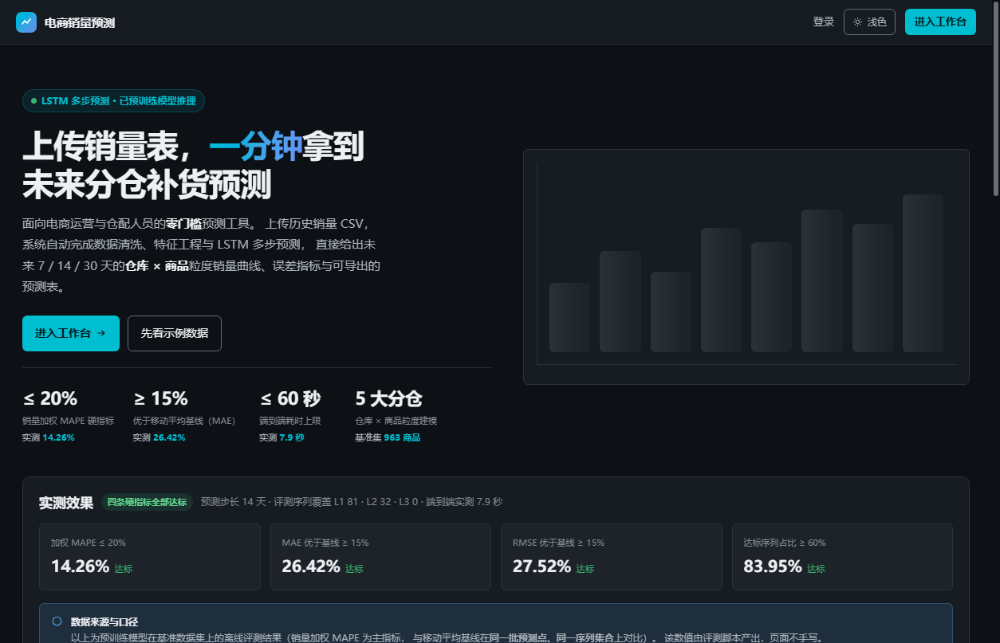
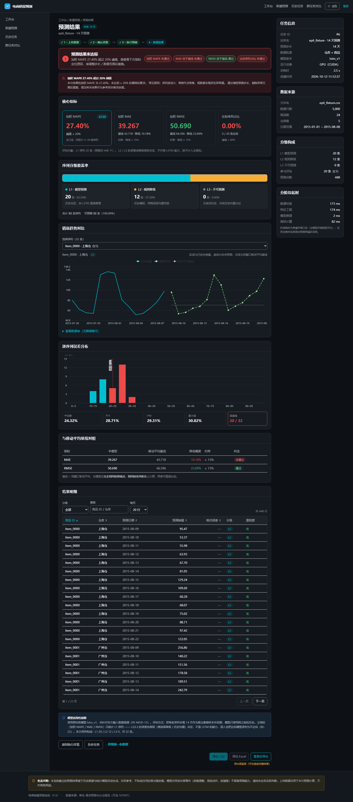
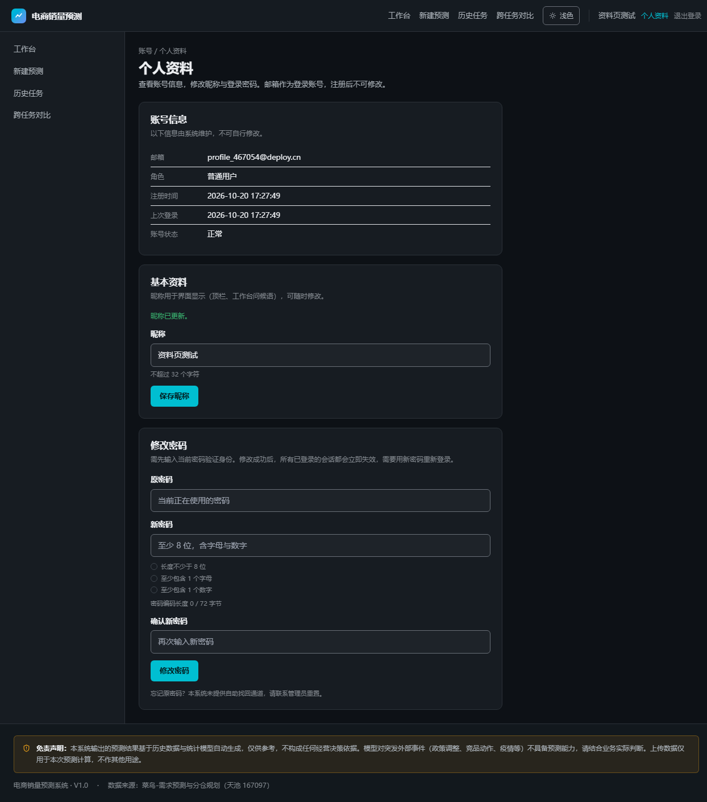

# 电商销量预测系统

    

> 面向「**仓库 × 商品**」粒度的销量预测 Web 应用：上传 CSV → 校验与特征工程 → LSTM 预测 → 结果可视化与导出，含历史任务、跨任务对比与运营管理端。
>
> **纯预训练推理**（请求内不训练），端到端 **≤ 60 s** 硬约束；对稀疏商品按 `L1→L2→L3` 三级降级，宁可如实标注「不可预测」也不硬凑数字。

## 在线体验（Demo）

| 入口 | 链接 | 说明 |
|---|---|---|
| 🚀 **前端应用** | **https://sales-forecast-27153.app.workbuddy.host/** | 打开即用（首次访问需 15–30 s 冷启动） |
| 📘 接口文档 | https://sales-forecast-27153.app.workbuddy.host/docs | Swagger UI，静态资源已离线化，零外链 |
| 🧩 静态设计原型 | [`prototype/index.html`](prototype/index.html) | clone 后双击即看，**不依赖任何服务** |

**三步跑通一次预测**（无需准备数据）：

1. 打开上面的前端地址 → 点「**注册**」创建账号（邮箱 + 密码，即时生效）
2. 登录后进「新建预测」→ 点「**加载示例数据**」（内置 40 SKU × 5 仓 / 113 条序列 / 220 天）
3. 选预测步长 → 提交 → 结果页给出四项指标、移动平均基线对照与逐序列曲线

> 🧪 **想试校验失败分支？** `demo/` 下有三份数据 —— `演示数据_正常.csv`／`演示数据_失败_缺仓库列.csv`／`演示数据_失败_负销量.csv`，
> 也可从 [v1.0.0 附件](https://github.com/LVLILOVE/ecommerce-sales-forecast/releases/tag/v1.0.0) 直接下载，上传后能看到 7 步校验的逐项报错与错误明细 CSV。

> **为什么必须注册**：线上版本关闭了「游客免登录」（`ALLOW_GUEST=false`）。这是刻意的安全取舍 —— 原设计把游客数据放在共享桶（`user_id = 0`），公开部署会让访客上传的销量表互相可见。
> 想免登录试用，请按 §四 本地运行并设 `ALLOW_GUEST=true`（默认值）。

<details>
<summary>⚠️ 在线地址打不开？几种替代方式</summary>

在线环境是免费沙箱：**闲置会被缩容**，冷启动需 15–30 s。若等 60 s 仍无响应，改用下面任一种：

| 方式 | 做法 | 能看到 |
|---|---|---|
| **静态原型（本机）** | clone 后双击 `prototype/index.html` | 13 个页面的完整视觉与交互（合成数据，零依赖） |
| **静态原型（在线版）** | https://lvlilove.github.io/ecommerce-sales-forecast/ | 同上，**无需 clone**。<br>⚠️ `github.io` 在中国大陆常被间歇阻断（本机实测：同域 4 个边缘 IP 有 2 个 TCP 超时），打不开请用上一行 |
| **本地完整运行** | §四「快速开始」：`pip install -r requirements.txt` + `npm run dev` | 全部功能，含真实 LSTM 推理 |
| **截图与实测数据** | `docs/assets/readme/`、`outputs/` | 界面外观、验收截图、指标报告 |

</details>



---

## 一、实测指标

| 指标 | 要求 | 实测 | 余量 |
|---|---|---|---|
| 加权 MAPE（WAPE） | ≤ 20% | **14.26%** | 5.74 pp |
| MAE 相对移动平均基线 | ↓ ≥ 15% | **↓ 26.42%** | 11.42 pp |
| RMSE 相对移动平均基线 | ↓ ≥ 15% | **↓ 27.52%** | 12.52 pp |
| 达标序列占比 | ≥ 60% | **83.95%** | 23.95 pp |
| 端到端耗时（h=14） | ≤ 60 s | 本机 7–12.7 s / 托管 CPU 15–23 s | — |

数据源：天池「菜鸟-需求预测与分仓规划」167,097 条。以上数字全部由 `scripts/eval_report.py` 产出并经 `verify_ep6_api` 与界面逐字段比对，**界面与算法不存在两套数字**。



---

## 二、功能范围

| 模块 | 能力 |
|---|---|
| **数据上传** | CSV 上传（≤20 MB / ≤50 万行 / ≤1000 序列）· 7 步校验（缺列 / 日期不可解析 / 负销量 / 断档 / 数据量不足…）· 错误明细 CSV 下载 · 前 20 行预览 · 标准模板下载 |
| **特征工程** | 缺失插值 · 尖峰截断（保留营销节点）· 日历 / 滞后 / 滚动特征 · **按序列 8:1:1 切分**（禁止随机切分） |
| **预测** | 多层 LSTM 学**残差**（相对移动平均基线）· 三级降级 `L1` 模型 / `L2` 规则 / `L3` 历史均值 · 超时**软失败**（返回可执行建议而非 500） |
| **结果** | 四项指标 + 基线对照 · 覆盖率面板（L1/L2/L3）· 逐序列曲线 / 误差分布直方图 · 明细分页 · CSV 导出（BOM，Excel 直开不乱码） |
| **历史与对比** | 任务列表（筛选 / 分页 / 汇总）· 软删除（二次确认，凭任务 ID 逐字输入）· 2–4 个任务曲线叠加对比 |
| **用户与权限** | 注册 / 登录 / 登出 · **个人资料（改昵称、改密码，改密后全端强制重新登录）** · 管理端（运营看板 / 用户管理 / 任务管理 / 模型版本 / 操作审计） |



---

## 三、技术栈

| 层 | 选型 |
|---|---|
| 前端 | React 18.3 + TypeScript 5 + Vite 5 + Tailwind CSS + ECharts 5（懒加载 + 主题令牌重绘） |
| 后端 | FastAPI 0.141 + Uvicorn 0.52 + Pydantic v2 + SQLAlchemy 2 |
| 数据 | SQLite（WAL）· 8 表 / 121 列 / 1 视图 / 3 触发器 / 12 索引 |
| 算法 | PyTorch 2.9（多层 LSTM + Adam + 学习率衰减 + 早停）· pandas / numpy |
| 认证 | JWT（HS256）+ bcrypt(12) · `token_version` 撤销 + `jti` 黑名单 · 登录限流落库 |

设计纪律（图表色绑定 CSS 令牌、结果页零二次聚合、阈值单一真源等）见 `docs/电商销量预测系统_开发技术文档_V1.0.md`。

---

## 四、快速开始

### 前置

- Python **3.12**（开发环境为 conda 环境 `deploy`）
- Node **20+**
- 无需 GPU：CPU 推理 h=14 约 7–23 s，仍在 60 s 预算内

### 1) 后端（端口 8000）

```bash
pip install -r requirements.txt
# GPU（可选）：pip install torch --index-url https://download.pytorch.org/whl/cu128
# 纯 CPU：      pip install torch --index-url https://download.pytorch.org/whl/cpu

cp .env.example .env          # 填入 JWT_SECRET（≥32 字符随机串）
python -m uvicorn app.main:app --host 127.0.0.1 --port 8000
```

首次启动会自动建库（`code/db/schema.sql` + `seed.sql`）并加载 `outputs/models/lstm_v1.pt`。

### 2) 前端（端口 5173）

```bash
cd web
npm install
npm run dev                   # http://localhost:5173/
```

> ⚠️ **本项目只能通过 dev server 运行**，不存在「双击 HTML 即用」的形态：
> `main.tsx` 使用 `BrowserRouter`（`file://` 下子路由必 404），且后端地址只存在于 Vite 代理层（`vite.config.ts`），打包产物里不留内网地址。

### 3) 账号

种子管理员见 `code/db/seed.sql`（邮箱 + bcrypt 哈希）。

> 🔒 **部署到公网前必须修改管理员密码**，并重新生成 `JWT_SECRET`。
> 登录后可在顶栏「个人资料」自助改密（本页同时支持改昵称）。

### 4) 一键体检

```bash
curl http://localhost:5173/api/v1/datasets/sample | head -c 60   # 须为 JSON（验代理）
curl http://localhost:5173/src/styles/index.css | wc -c           # 须为万字节级（验 Tailwind 已编译）
```

这两条能一次性排掉「页面能开但数据全空 / 布局崩坏」两大类事故。

---

## 五、目录结构

```
.
├── app/                 # FastAPI 后端（api / services / dao / models / algo / core）
├── code/
│   ├── db/              # schema.sql（建表唯一真源）+ seed.sql
│   ├── backend/         # schemas.py（运行期被 app/schemas 加载）
│   └── frontend/        # 前后端共享类型契约
├── web/                 # React 前端（Vite）
├── prototype/           # 13 个纯静态设计原型（双击即看，无需服务）
├── docs/                # 13 份 Markdown 交付文档（+ 图片资源）
├── outputs/             # 交付产物：14 组 docx/pdf、契约、模型、演示数据、答辩材料
├── scripts/             # 38 套自动化校验与工程流水线
├── demo/                # 冻结演示数据集（含 2 个失败分支）
├── deploy/              # 部署暂存目录（含生产密钥，**不入库**）
└── 前端.html / 后端.html / 产品原型.html   # 三份自包含本机导航页
```

---

## 六、质量保障

分两层，**分工明确、不互相替代**：

| 层 | 工具 | 特点 | 何时跑 |
|---|---|---|---|
| **单元 / 不变量** | `pytest`（30 例）· `vitest`（20 例）· `ruff` | 毫秒级、零外部状态（不建库、不加载模型） | 每次提交（**已进 CI**） |
| **端到端 / 契约** | `scripts/verify_*`（38 套） | 真实服务 + 真实模型 + 真实浏览器 | 交付前本地回归（需模型权重，不进 CI） |

```bash
# 单元层（CI 同款）
ruff check app tests     # 静态检查
pytest -q                # 后端：导出转义 / 分块流式 / 错误码不变量
cd web && npm run test   # 前端：格式化 / 密码字节上限（与后端同源）
```

> 单测**刻意只覆盖纯函数与不变量**（如「CSV 公式注入必须被转义」「流式产物与一次性拼接逐字节一致」
> 「错误码不得重复」）。覆盖率不是目标 —— 端到端失真（例如导出在服务层被整体物化）只能靠 `verify_*` 抓。

端到端层不依赖人工目视，由 **38 套可复现断言脚本**兜底：

```bash
# 数据与契约
python scripts/verify_schema.py        # DDL 可执行性 / 约束 / 幂等
python scripts/verify_orm.py           # ORM ↔ schema.sql 一致性 + 红线自检
python scripts/verify_schemas.py       # Pydantic 行为（61 项）
python scripts/verify_auth.py          # 认证闭环 + 限流 + 72 字节边界（39 项）

# 端到端
python scripts/verify_ep4_api.py       # 上传链路（5 类错误 / 3 类上限 / 游客链路）
python scripts/verify_ep5_api.py       # 预测链路（60 项，含 ≤60 s 断言与超时软失败）
python scripts/verify_ep6_api.py       # 结果链路（指标与 eval_report 逐字段一致）
python scripts/verify_ep7_api.py       # 历史 / 对比 / 软删除
python scripts/verify_ep8_api.py       # 管理端 9 接口 + 越权 + 审计

# 文档与导出
python scripts/verify_doc_refs.py      # 编号悬空守卫（FR-* / NFR-*）
python scripts/verify_doc_exports.py   # docx/pdf 齐备 + 新鲜度 + TOC 已展开
```

浏览器层用 **Edge + CDP 无头**做真实走查（`scripts/verify_ep*_browser.mjs`），断言渲染结果与 `consoleErrors = 0`，而非只看 HTTP 200。

> 详细用例与失败登记（含 3 项未达成与 5 项遗留）见 `docs/电商销量预测系统_测试报告_V1.0.md`。

---

## 七、部署

两种形态：

| 形态 | 做法 | 适用 |
|---|---|---|
| **Nginx + systemd**（推荐） | `npm run build` 产物交 Nginx 静态托管，`/api` 反向代理到 `127.0.0.1:8000` | 有自有服务器 / 域名 |
| **单端口托管**（`SERVE_FRONTEND=1`） | FastAPI 同时托管前端产物 + API + SPA 兜底 | 平台托管、无 Nginx |

```bash
SERVE_FRONTEND=1 FRONTEND_DIR=web/dist ALLOW_GUEST=false python -m uvicorn app.main:app --host 0.0.0.0 --port 8000
```

> 本仓库上方的**在线 Demo 就是「单端口托管」形态**（`SERVE_FRONTEND=1` + `ALLOW_GUEST=false`），前端产物由 FastAPI 直接托管、SPA 深链兜底，无需 Nginx。

必读：`docs/电商销量预测系统_部署运维手册_V1.0.md`（Nginx / systemd / 备份 / 监控 / 容量）；
公网发布与权限收敛见 `outputs/对外发布与多用户访问方案_V1.0.md`。

⚠️ **`--workers` 必须为 1**：登录限流计数与登出 `jti` 黑名单在进程内存，多进程会让限流与撤销失效。

**数据备份**（SQLite 在 WAL 模式下**不可直接 `cp`**，会拿到缺 WAL 内容的不一致快照）：

```bash
python scripts/backup_db.py --keep 7      # 在线备份 + 轮转 + integrity_check + 逐表行数比对
```

建议挂到 cron / 任务计划程序（手册 §7.1 有示例）。备份产物落在 `backups/`（已 gitignore）。

---

## 八、文档索引

`docs/*.md` 均有对应的 `outputs/*.docx` 与 `*.pdf`（真 Heading 样式、TOC 域已展开、页眉页脚页码，合计约 769 页）：

| 文档 | 内容 |
|---|---|
| PRD | 88 条功能需求（P0/P1/P2/P3）+ 验收标准 |
| 开发方案文档 | 架构决策与技术选型 |
| 开发技术文档 | 模块设计、接口契约、算法细节（最厚一份） |
| 数据库设计文档 | 8 表 121 列、索引、触发器、ER 图 |
| UI/UX 设计文档 | 13 个页面规范、设计令牌、无障碍要求 |
| 项目开发实施方案 | 11 个阶段的任务分解与完成门槛 |
| 测试报告 | 用例、失败登记、遗留清单 |
| 部署运维手册 | 两种部署形态 + 运维操作 |
| 其余 | AI 协作教程、RAG 语料库、项目说明、演示脚本、文件总览、接口文档（单文件 HTML，零外链） |

---

## 九、已知限制（如实登记）

| 项 | 说明 |
|---|---|
| 并发能力 | `workers=1` ⇒ 任务实际串行，3 并发各 32–38 s；扩容需先迁 Redis + PostgreSQL |
| 极限规模 | 1000 序列 × `horizon=30` 走**软失败**（`E_TIMEOUT`），非 60 s 内完成 |
| 找回密码 | `FR-USR-09` 属 P2，未实现；忘记密码需管理员重置 |
| 置信区间 / 特征重要性 | `FR-MOD-14` / `FR-FEA-11` 属 P2，未实现 |
| Safari | Windows 无发行版，浏览器覆盖 3/4（Edge / Chrome / Firefox 各 109/109） |
| 单元测试 | 只覆盖**纯函数与不变量**（30 pytest + 20 vitest）；业务编排仍靠 `scripts/verify_*` 端到端断言，**无行覆盖率指标** |
| 前端产物体积 | ECharts 分包 1,035 kB（gzip 344 kB），已懒加载，未做 `manualChunks` 拆分 |

---

## 十、许可

见 [LICENSE](LICENSE)。

> 免责声明：本系统输出的预测结果基于历史数据与统计模型自动生成，仅供参考，不构成任何经营决策依据。模型对突发外部事件（政策调整、竞品动作、疫情等）不具备预测能力。上传数据仅用于本次预测计算。
